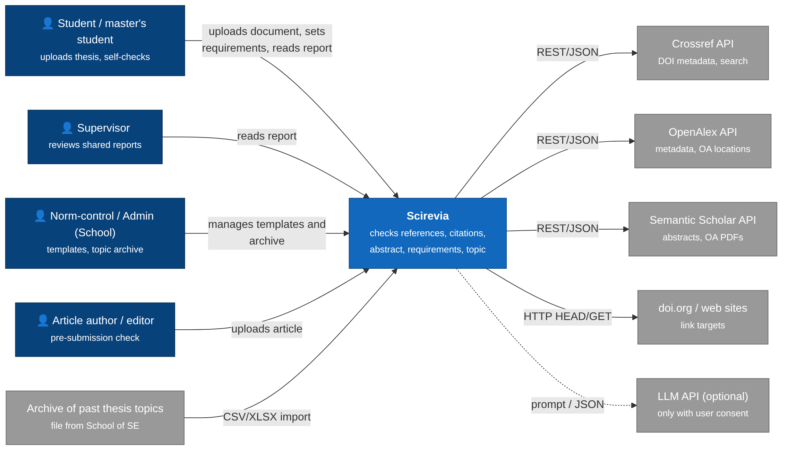

# Scirevia

**Development of a System for Comprehensive Analysis and Evaluation of Scientific Information Using Digital and Intelligent Technologies**
*Разработка системы комплексного анализа и оценки научной информации с использованием цифровых и интеллектуальных технологий*

Diploma project · Astana IT University · School of Software Engineering · 2026–2027

> **Status:** Pre-defense 1 — analysis and design package (tag `pre-defense-1`). Implementation starts in November 2026 (milestone M3).

---

## What Scirevia does

Scirevia is a web system that checks scientific texts (diploma theses, projects and articles) and produces one report for the author and the reviewer. It runs five checks:

| Check | Question it answers |
| --- | --- |
| **References** | Does each link / DOI work and lead to the source stated in the reference list? Does the source exist at all? |
| **Citations** | Does the cited source actually support the statement in the text? |
| **Abstract** | Does the author's abstract reflect the real content of the work? |
| **Requirements** | Does the document meet the requirements the user sets (structure, volume, number and age of references, style)? |
| **Topic** | Is the topic too similar to theses of previous years? |

Plagiarism systems answer *"is the text copied?"*. Scirevia answers *"are the references and citations correct?"* — it complements them, not replaces them.

## Problem and target users

- **Problem:** supervisors and norm-control staff check references, citations, abstracts and formal requirements manually. In our survey S-1 (N = 26), 58% of respondents had met broken or unverifiable references, 65% spend 15+ minutes per document, and 58% named "checking whether sources support citations" as the hardest task.
- **Target users:** bachelor's and master's students, academic supervisors, norm-control and topic-approval staff, authors and editors of scientific articles.
- **Expected outcome:** a working web system (client, server, analysis service) evaluated on a control sample of AITU theses, with documentation and recommendations for use at the School.

## Team

| Member | Role | Area | GitHub |
| --- | --- | --- | --- |
| Saltanat Sergeyeva (SE-2403) | ML / Data engineer | Analysis service: NLP, citation verification, summarisation, topic similarity, metadata (OpenAlex / Crossref / Semantic Scholar) | [@ssaltuwwa](https://github.com/ssaltuwwa) |
| Alzira Kuanyshbekova (SE-2403) | Frontend developer, UX/UI designer | Prototype, client, requirements window, report visualisation | [@Akua49](https://github.com/Akua49) |
| Meruert Khairgeldinova (SE-2414) | Backend developer | REST API, document upload and extraction, link and DOI checking, storage | [@tw3tyy](https://github.com/tw3tyy) |

**Supervisor:** Almas Myrzakhmetov, Senior Lecturer, School of Software Engineering

## Links

| | |
| --- | --- |
| Pre-defense 1 report (PDF) | [docs/report/Scirevia_Report_PreDefense1.pdf](docs/report/Scirevia_Report_PreDefense1.pdf) |
| YouTrack (project SCI) | https://sergeyevasss.youtrack.cloud/projects/SCI |
| Figma prototype | https://www.figma.com/proto/Gu5Z6gvbep6zOqVz4ASxwa/Scirevia-%E2%80%94-Prototype?node-id=9-150 |
| Prototype screenshots | [prototype/screens/](prototype/screens/) |

## Documentation (pre-defense 1)

| # | Document | Owner |
| --- | --- | --- |
| 1 | [Project proposal and scope](docs/01-proposal.md) | S. Sergeyeva |
| 2 | [Evidence of relevance, survey S-1](docs/02-relevance-evidence.md) · [questionnaire](docs/evidence/survey-S1-questionnaire.md) · [responses (CSV)](docs/evidence/survey-S1.csv) | A. Kuanyshbekova |
| 3 | [Literature review (26 sources)](docs/03-literature-review.md) | S. Sergeyeva |
| 4 | [Existing systems comparison](docs/04-existing-systems.md) | A. Kuanyshbekova |
| 5 | [Technology comparison](docs/05-technology-comparison.md) · [ADR-001…005](docs/adr/) | M. Khairgeldinova |
| 6 | [Requirements specification](docs/06-requirements.md) | S. Sergeyeva |
| 7 | [Architecture and diagrams](docs/07-architecture.md) · [API contracts (OpenAPI, draft)](docs/api/) | M. Khairgeldinova |
| 8 | [UX / prototype](docs/08-prototype.md) | A. Kuanyshbekova |
| 9 | [Verification and evaluation plan](docs/09-verification-plan.md) | S. Sergeyeva |
| 10 | [Project management and risks](docs/10-project-management.md) | A. Kuanyshbekova |
| 11 | [Supervisor feedback log](docs/11-supervisor-feedback.md) | A. Kuanyshbekova |

## Architecture



| Component | Technology |
| --- | --- |
| Client | HTML, CSS, JavaScript (ES modules), Chart.js; design in Figma |
| Server | Node.js, Express.js, MongoDB (Mongoose), REST API + OpenAPI (Swagger) |
| Analysis service | Python, FastAPI, spaCy / NLTK, scikit-learn, Hugging Face Transformers (multilingual embeddings, NLI); LLM API optional, only with user consent |
| External sources | Crossref, OpenAlex, Semantic Scholar API, doi.org |
| Infrastructure | Docker Compose, GitHub, YouTrack |

Components talk over REST/JSON; long checks run as asynchronous jobs (ADR-003). More diagrams: [use cases](diagrams/02-use-case.png), [components](diagrams/03-components.png), [data model](diagrams/04-data-model.png), [check sequence](diagrams/05-sequence.png); editable sources in [diagrams/source/](diagrams/source/).

## Scope

- **In scope:** DOCX and text-based PDF in Russian, Kazakh and English; the five checks above; roles student / supervisor / admin; web client; single report with PDF export.
- **Out of scope:** plagiarism detection (covered by existing tools), retrieval of paywalled full texts, grammar and style checking. Mobile app — optional (Could).
- **Privacy:** documents are processed locally by default and are not sent to external LLM services without the user's consent.

## Repository structure

```
docs/            pre-defense documentation (sections 1–11), ADRs, API contracts
  adr/           architecture decision records
  api/           OpenAPI contracts: server and analysis service (draft)
  evidence/      survey S-1: questionnaire and anonymised responses
  report/        pre-defense report (PDF)
diagrams/        exported diagrams (PNG)
  source/        editable diagram sources (Mermaid .mmd, PlantUML .puml)
prototype/
  screens/       screenshots of the Figma prototype
src/             source code by component (from M3)
tests/           automated tests (from M3)
config/          configuration examples (no passwords or keys)
```

## How we work

- **Tasks:** every task has a key in YouTrack (`SCI-<n>`).
- **Branches:** `SCI-<n>-<short-name>`, created from `main`.
- **Commits:** `SCI-<n>: <what was done>`.
- **Pull requests:** every PR is reviewed and approved by another team member before merge; the supervisor reviews significant changes at bi-weekly meetings.
- **Tags:** `pre-defense-1`, `pre-defense-2`, `final-pre-defense`.

## Milestones

| # | Stage | Date |
| --- | --- | --- |
| M1 | Requirements and data analysis — **pre-defense 1** | 24.10.2026 |
| M2 | Design: architecture, API, storage schema, UI mockups | 15.11.2026 |
| M3 | Base version: upload, reference extraction, link checking | 20.12.2026 |
| M4 | Text analysis: citation check, abstract comparison | 15.02.2027 |
| M5 | Requirements and topic checks — **pre-defense 2** | March 2027 |
| M6 | Integration and testing on the control sample | 15.04.2027 |
| M7 | Documentation — **final pre-defense** | May 2027 |

## Setup, running and testing

There is no runnable application yet: pre-defense 1 covers analysis and design. Instructions for installation (Docker Compose), running and testing will be added with the first runnable version (milestone M3, SCI-18).
